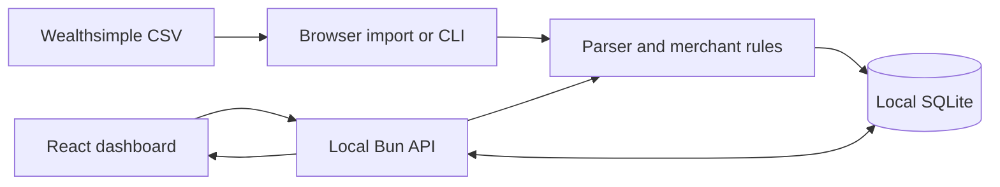

# Finguin

A local finance dashboard for Wealthsimple exports. Import your accounts, review spending, track recurring payments, and plan a first home purchase.

- Dashboard with cash flow, spending categories, and net worth.
- Transactions with search, month filters, merchant grouping, and manual categories.
- Accounts with cash balances, holdings, and home savings allocations.
- Insights with savings rates, spending changes, recurring cash forecasts, and investment performance.
- Home goal with mortgage payments, closing costs, reserves, and savings scenarios.

## Run it

Install [Bun](https://bun.sh) 1.4.4 or newer and Git. Run these commands from your checkout:

```sh
bun install --frozen-lockfile
bun run setup:git
bun run dev
```

Open http://127.0.0.1:5186. Vite proxies `/api` to the Bun server on port 5187. Both servers bind to loopback.

Startup creates an empty `data/finguin.db`. Tests use synthetic data.

## Hosted demo

[Open the fictional-data demo](https://carsonsgit.github.io/finguin/).

```sh
bun install --frozen-lockfile
bun run build:demo
bun run preview:demo
```

Preview at http://127.0.0.1:5188. Pushes to `main` run checks and deploy only `dist/demo/` to GitHub Pages.

The demo generates 12 months of fictional activity across four accounts. Visitors can edit categories, allocations, and plans in their own tab.

Refreshing resets edits. CSV imports are blocked. The demo uses no API, SQLite file, or credentials; your personal app still starts empty.

## Import your accounts

Use **Import CSV** in the app, or run:

```sh
bun run import /path/to/chequing-activities.csv /path/to/account-activities.csv
```

| Export | Contents |
| --- | --- |
| Chequing activity | Purchases, deposits, e-transfers, bill payments, internal transfers |
| Account activities | TFSA, FHSA, RRSP contributions, trades, dividends, interest, tax |

Re-importing an overlapping export skips existing rows. Manual category changes survive re-imports.

Open transactions to review categories. Direct deposits initially count as transfers; mark paycheques as Salary.

## Your data stays local

SQLite stores your financial data and settings locally.

Finguin has no external AI classification, bank connection, analytics service, or cloud sync. Imports and calculations run on your machine.

Git excludes databases, SQLite sidecars, CSVs, environment files, backups, logs, and build output. `bun run setup:git` installs commit and push hooks.

The hooks reject unapproved paths, databases, and recognizable secrets. Push checks include every local commit.

```sh
bun run check:privacy
bun run check:privacy --history
```

Hooks can be bypassed and pattern checks cannot identify every personal detail. Review source fixtures and documentation before sharing them. Keep real exports under `imports/` or outside the checkout.

The API has no authentication. Run it locally; exposing its port gives other people access to your financial data.

## Back up and restore

Stop both servers before copying SQLite files. Copy the entire `data/` directory, including any `-wal` and `-shm` files, to another local location.

To restore, stop the servers, move the current directory aside, copy your saved directory back to `data/`, then restart. Keep the original CSVs separately.

## Settings

Bun loads `.env` automatically. Copy `.env.example` if you need overrides.

| Variable | Default | Purpose |
| --- | --- | --- |
| `FINGUIN_DB` | `data/finguin.db` beside the app | SQLite file; relative overrides resolve from the working directory |
| `FINGUIN_API_PORT` | `5187` | Local API port |

Update `vite.config.ts` when changing ports. SQLite saves planning values entered in the app.

## How it fits together



## Limits

Balances depend on export coverage. Accounts starting mid-history can show partial balances. Holdings use the last traded price in the export, without live quotes.

Transfer matching, recurring detection, and forecasts use heuristics; verify them against your records.

## Checks

```sh
bun test
bun run check
bun run typecheck
bun run build
bun run check:privacy --history
```

`bun run build` produces frontend files in `dist/`. Run locally through the development command; the API does not serve the production bundle.

## Assets

Merchant logos come from [Simple Icons](https://simpleicons.org) (CC0). Category artwork comes from [Microsoft Fluent Emoji](https://github.com/microsoft/fluentui-emoji) (MIT). Charts live in `vendor/bklit`, with their license.
